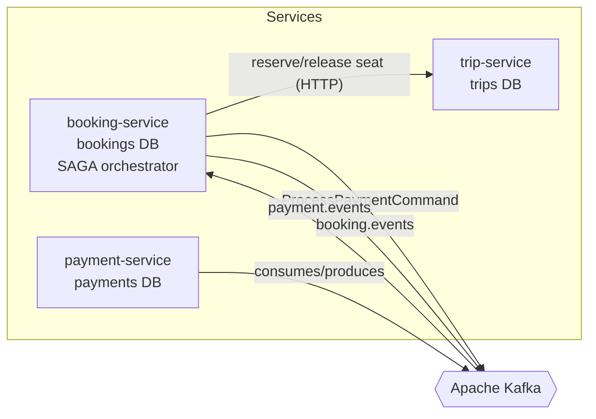
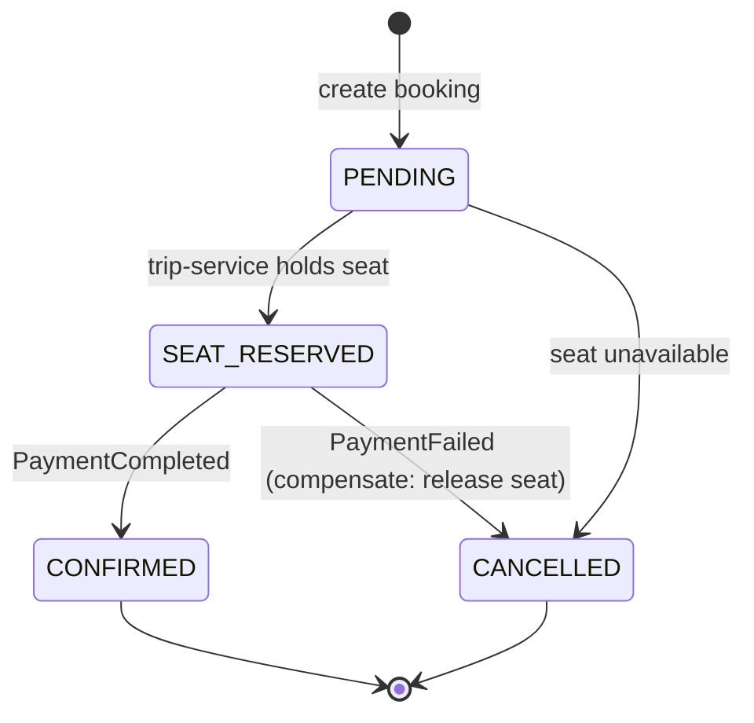
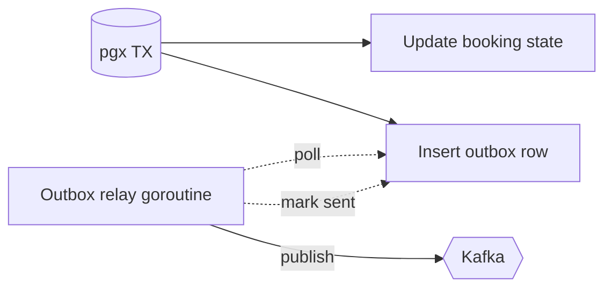
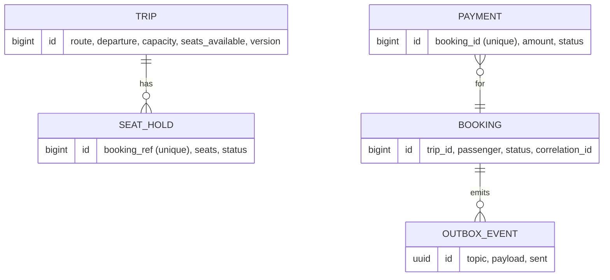

# TransitFlow (Go) — Architecture

This document explains **how** the Go edition of TransitFlow is built and **why**.
The guiding constraint is the one that defines distributed systems: each service
owns its data, and there is no shared database transaction spanning services.
Every decision below follows from that.

This is a faithful port of the Java/Spring reference ([`transitflow`](https://github.com/Feliper83/transitflow)):
same domain, same event field names, same flow — expressed idiomatically in Go
with `chi`, `pgx`, and `kafka-go`, and no ORM (plain SQL with
`CREATE TABLE IF NOT EXISTS` migrations run on startup).

## 1. Context

A booking touches three bounded contexts:

- **Trips** — what seats exist and whether they're available.
- **Bookings** — the passenger's intent and its lifecycle.
- **Payments** — money, which can succeed or fail.

These are separate services with separate PostgreSQL databases. The challenge is
making a booking *atomic from the passenger's point of view* while each service
commits only to its own database.

## 2. Communication styles — and when we use each

| Style | Used for | Why |
|-------|----------|-----|
| **Synchronous REST** | `booking → trip` seat reservation | The booking cannot proceed without a confirmed seat hold. We need an immediate yes/no, and it is naturally request/response. |
| **Asynchronous events (Kafka)** | payment flow, booking events | Payment is slow and can fail; the passenger shouldn't hold a connection open for it. Decoupling buys resilience and independent scaling. |

> **Trade-off:** the synchronous seat reservation introduces temporal coupling
> between `booking` and `trip`. We accept it because a seat hold must be
> immediate and strongly consistent; we isolate the blast radius with a timeout
> and treat a reservation failure as a terminal booking failure (no SAGA needed).

## 3. The consistency problem and the SAGA solution

A booking that reserves a seat **and** charges a card spans two services'
databases. A distributed transaction (2PC) would couple their availability and
doesn't scale. Instead we use an **orchestrated SAGA**: a sequence of local
transactions, each with a **compensating action** that semantically undoes it.

`booking-service` is the orchestrator. It owns the state machine:

The orchestrator (`internal/booking/orchestrator.go`) performs the remote calls
to trip-service *outside* any database transaction. The atomic state-change +
outbox writes are delegated to the `Store` (`internal/booking/store.go`), so each
step commits cleanly. See [ADR-0003](docs/adr/0003-saga-orchestration-over-choreography.md).

## 4. Reliable event publishing — the outbox pattern

When the orchestrator changes a booking's state it must also publish an event.
Writing to the DB and then producing to Kafka as two steps is a **dual-write**: a
crash in between loses the event or publishes one for a rolled-back change.

The **transactional outbox** fixes this. The event row is inserted into
`outbox_events` **in the same pgx transaction** as the state change (see
`writeOutbox` in `internal/booking/store.go`). A separate relay goroutine
(`internal/booking/outbox.go`) polls unsent rows every ~2s, publishes them to
Kafka, and flips `sent`.

The DB transaction is the single source of truth; Kafka catches up at-least-once.
See [ADR-0004](docs/adr/0004-transactional-outbox.md).

## 5. Idempotent consumers

Kafka guarantees **at-least-once** delivery, and the outbox relay can itself
re-publish a row. Charging a card twice is unacceptable, so every side-effecting
consumer is **idempotent**:

- `payment-service` stores payments with a `UNIQUE (booking_id)` constraint; a
  duplicate `ProcessPaymentCommand` returns the stored result instead of charging
  again (`internal/payment/payment.go`).
- `booking-service` treats a terminal booking as done, so a redelivered
  `payment.events` message neither re-confirms nor double-compensates.

Consumers commit the Kafka offset only **after** the work and any resulting
publish succeed (`FetchMessage` + explicit `CommitMessages`), so a crash
mid-processing re-delivers rather than loses. See
[ADR-0005](docs/adr/0005-idempotent-consumers.md).

## 6. Correlation IDs

A correlation id enters at the HTTP edge via the `X-Correlation-Id` header
(minted if absent), is stored on the request context, propagated to trip-service
on outgoing HTTP calls, and carried in the `correlationId` field of every event.
A single booking is therefore traceable across all three services' logs
(`internal/httputil`).

## 7. Data ownership

No service reads another's tables. `trip-service` never sees a `payment` row; it
only knows a seat was held against a booking reference. Inventory is protected
against concurrent reservations with an **optimistic version column** plus a
guarded `UPDATE ... WHERE seats_available >= n`, so the system cannot oversell.

## 8. Deliberate non-goals

To keep the codebase readable, the following are **named but not built** (the
point of a staff-level system is the trade-offs it names):

- **Dead-letter queues** — a poison message is logged and skipped; production
  would route it to a `<topic>.DLT` with bounded retry and a replay tool.
- **Schema registry / Avro** — events are JSON; a real platform would enforce
  contracts with a registry.
- **Distributed tracing backend** — correlation ids are propagated, but there's
  no OpenTelemetry/Tempo wiring.
- **Exactly-once Kafka semantics** — we rely on idempotent consumers instead,
  the pragmatic industry default.
- **Money as float64** — amounts are modeled as `float64` for brevity across the
  Go services. A production ledger would use a fixed-point / decimal type.
