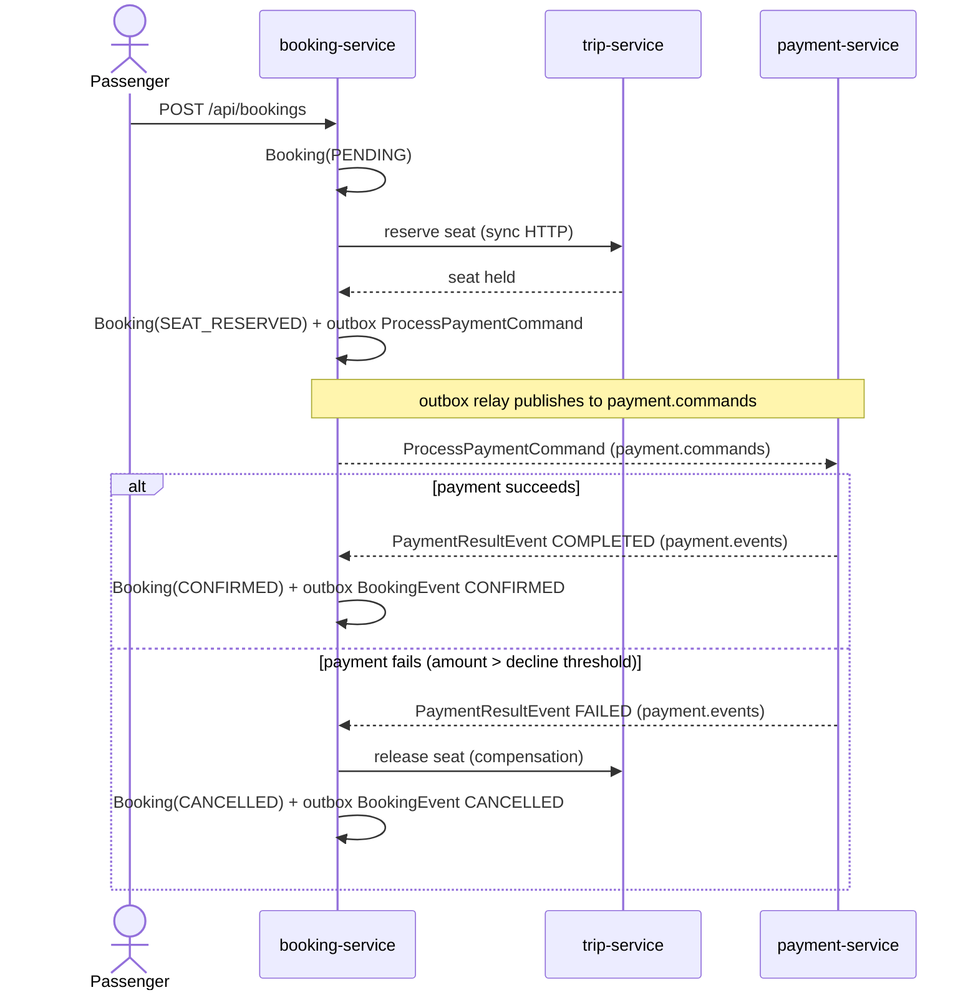
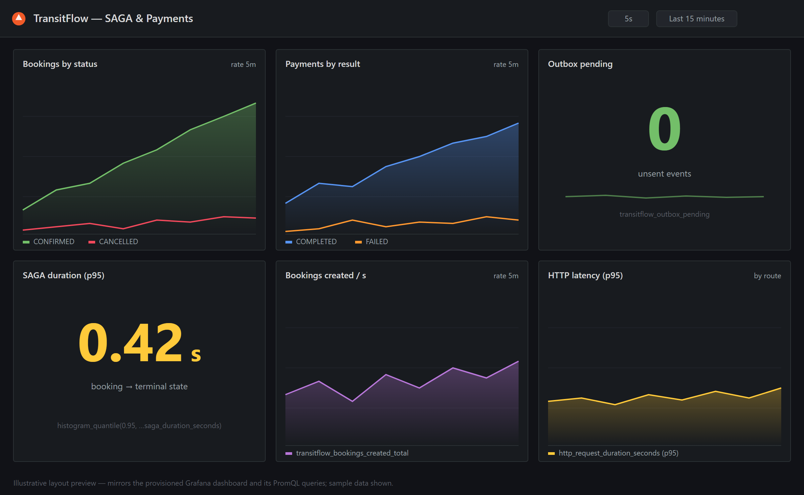

<div align="center">

# 🚍 TransitFlow (Go)

**An event-driven transit ticketing platform — microservices, Kafka, and the SAGA pattern, built to production-grade standards, in idiomatic Go.**

Buy tickets, reserve seats, and process payments across a choreography of independent services that stay consistent **without distributed transactions** — using an orchestrated SAGA with compensation, the transactional outbox pattern, and idempotent consumers.


</div>

---

## Why this project exists

Most "microservices demo" repos are a REST monolith split into folders. This one
models the hard part of distributed systems: **keeping data consistent across
services that each own their own database, when there is no shared transaction**.

The booking flow spans three services and a payment that can fail. TransitFlow
solves it the way real platforms do — with an **orchestrated SAGA** and
**compensating actions**, reliable event publishing via the **transactional
outbox pattern**, and **idempotent consumers** so that a redelivered Kafka
message never double-charges a passenger.

> 📐 Read **[ARCHITECTURE.md](ARCHITECTURE.md)** for the full design, diagrams, and
> trade-offs, and **[docs/adr/](docs/adr/)** for the architecture decision records.

## The booking SAGA, in one picture



## Services

| Service | Port | Owns | Responsibility |
|---------|------|------|----------------|
| `trip-service` | 8081 | `trips` DB | Routes, schedules, seat inventory; idempotent reserve/release seats (HTTP) |
| `booking-service` | 8082 | `bookings` DB | **SAGA orchestrator**; owns booking lifecycle + transactional outbox |
| `payment-service` | 8083 | `payments` DB | Idempotent payment processing; consumes/produces Kafka events |

Each service is a separate Go binary under `cmd/`, sharing `internal/` packages
(`events`, `httputil`, `kafkautil`, `config`, `pg`).

## Run it

Everything — the three services, Kafka (KRaft mode), and one PostgreSQL per
service — comes up with a single command. No local Go toolchain required: each
service builds inside a multi-stage Docker image.

```bash
docker compose up --build
```

> **Note (corporate networks / TLS inspection):** the service images build with
> the Go toolchain *inside* the container. Go uses the OS/base-image certificate
> store, so `go mod download` validates the module proxy's certificate on most
> networks. If your network performs TLS inspection with a **private root CA**,
> either COPY that CA into the build stage and run `update-ca-certificates`, or
> build the binaries on the host (`go build ./...`) and COPY them in. **Never**
> disable certificate verification or set `GOINSECURE` as a workaround. On an
> unrestricted network (and in CI) `docker compose up --build` works as-is.

Then exercise the flow:

```bash
# 1. List available trips
curl http://localhost:8081/api/trips

# 2. Book a seat (triggers the SAGA) — Trip 1 is cheap and will CONFIRM
curl -X POST http://localhost:8082/api/bookings \
  -H 'Content-Type: application/json' \
  -d '{"tripId": 1, "passengerName": "Ada Lovelace", "seatCount": 1}'

# 3. Poll the booking until it reaches CONFIRMED (or CANCELLED)
curl http://localhost:8082/api/bookings/1
```

> 💡 The payment service **deterministically declines** payments above a
> configurable amount (`TRANSITFLOW_PAYMENT_DECLINE_ABOVE`, default `500.00`).
> Book **Trip 3** ("Andes Premium", 600.00) to watch the **compensation path**
> — seat release + booking cancellation — end to end:
>
> ```bash
> curl -X POST http://localhost:8082/api/bookings \
>   -H 'Content-Type: application/json' \
>   -d '{"tripId": 3, "passengerName": "Grace Hopper", "seatCount": 1}'
> ```

## Observability



> *Illustrative preview of the Grafana dashboard that `docker compose up` provisions automatically. Panels and PromQL queries match the live dashboard; replace with a real screenshot once the stack is running.*

`docker compose up --build` also starts a **Prometheus + Grafana** stack, so you
can watch the SAGA and payment flow live.

| Tool | URL | Notes |
|------|-----|-------|
| Prometheus | http://localhost:9090 | Scrapes every service's `/metrics` every 5s |
| Grafana | http://localhost:3000 | Anonymous **Admin** access (no login); dashboard pre-loaded |

Every service exposes a Prometheus `/metrics` endpoint on its HTTP port
(trip `:8081`, booking `:8082`, payment `:8083`). Grafana is provisioned with the
Prometheus datasource and the **"TransitFlow — SAGA & Payments"** dashboard out of
the box — open Grafana and it is already there.

**Business metrics** (names are shared across the Java/Go/Python ports so a single
dashboard works against any of them):

| Metric | Type | Meaning |
|--------|------|---------|
| `transitflow_bookings_created_total` | counter | bookings created |
| `transitflow_bookings_total{status}` | counter | bookings reaching a terminal state (`CONFIRMED` / `CANCELLED`) |
| `transitflow_payments_total{result}` | counter | processed payments (`COMPLETED` / `FAILED`) |
| `transitflow_outbox_pending` | gauge | unsent transactional-outbox rows (relay backlog) |
| `transitflow_saga_duration_seconds` | histogram | time from booking creation to terminal state |
| `transitflow_http_request_duration_seconds{method,route,status}` | histogram | HTTP request latency |

The dashboard panels cover booking throughput by status, payment results, the
outbox backlog, SAGA duration p95, booking-creation rate, and HTTP latency p95.

## Run the tests

```bash
go build ./...
go test ./...
```

The unit tests cover the core distributed-systems logic without needing any
infrastructure: payment idempotency + decline threshold, trip reservation
idempotency + capacity rejection, and the booking compensation decision (skip
when terminal).

## What this repo demonstrates

- **Database-per-service** with no shared schema — services integrate only
  through events and well-defined HTTP APIs.
- **Orchestrated SAGA** with explicit compensation, instead of a two-phase commit
  that doesn't scale.
- **Transactional outbox** — business state and the "event to publish" commit in
  the *same* pgx transaction, so an event is never lost or published for a
  rolled-back change; a background relay goroutine drains it to Kafka.
- **Idempotent consumers** keyed on the booking id — safe under Kafka's
  at-least-once delivery.
- **Optimistic concurrency** on seat inventory — a guarded `UPDATE` plus a
  version column means the system cannot oversell under concurrent bookings.
- **Correlation IDs** propagated across HTTP headers and carried in every event
  for traceable, debuggable flows.
- **Graceful shutdown**, structured logging (`log/slog`), and plain-SQL
  migrations run on startup.

## Tech

**Language:** Go 1.22 · **HTTP:** `go-chi/chi` · **DB:** `jackc/pgx/v5` (pgxpool),
no ORM · **Messaging:** `segmentio/kafka-go`
**Infra:** Apache Kafka (KRaft mode) · PostgreSQL · Docker Compose

## Polyglot trilogy

TransitFlow is implemented three times, same domain and event contracts, to
contrast idioms across ecosystems:

- ☕ **[`transitflow`](https://github.com/Feliper83/transitflow)** — Java 21 /
  Spring Boot (the reference implementation).
- 🐹 **`transitflow-go`** — Go 1.22 / chi / pgx / kafka-go *(this repo)*.
- 🐍 **[`transitflow-py`](https://github.com/Feliper83/transitflow-py)** — Python
  sibling.

## License

MIT — see [LICENSE](LICENSE).
